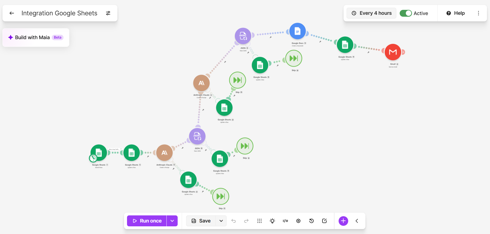
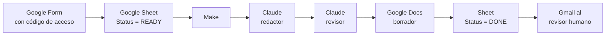

# Departamento de marketing con IA para una administradora de propiedades

Un equipo de IA que escribe y revisa anuncios de alquiler, correos y posts, hecho con Claude Code, la API de Claude y Make, con una persona que toma la decisión final.

🇺🇸 [English](README.md) · 🇪🇸 Español

[PLACEHOLDER: video demo link]



---

## El problema

Una empresa de administración de propiedades residenciales necesita textos de marketing para cada alquiler nuevo: un anuncio, un correo para interesados y un post para redes. Los textos deben seguir la voz de la marca, no inventar datos y cumplir la ley de vivienda justa (Fair Housing).

La empresa quiere un equipo de marketing con IA que haga este trabajo. Una persona sigue revisando todo antes de publicar.

**Grow Property Management** (San Diego, California) es una empresa ficticia. El proyecto está inspirado en una oferta de trabajo real, que no nombro aquí. Todos los datos de la empresa (licencia, teléfono, dominio) son marcadores.

## Qué hace

El proyecto tiene dos partes.

**1. Flujo automático (Make + API de Claude).** Alguien llena un formulario. Unas horas después, un revisor humano recibe un correo con los tres textos ya escritos y revisados por la IA.



- Dos escenarios de Make. "Formulario a Hoja" copia las respuestas nuevas a la hoja. El escenario principal toma una fila `READY` por ejecución.
- El redactor y el revisor son dos llamadas separadas a la API. Cada una tiene su propio system prompt y devuelve solo JSON.
- El correo trae el veredicto, si está listo para publicar, los pendientes obligatorios y el enlace al Doc.
- Nada se publica solo.

Detalles: [automatizacion/README.md](automatizacion/README.md).

**2. Departamento en Claude Code.** Cuatro subagentes y una skill, que se usan desde Claude Code:

| Agente | Trabajo |
|---|---|
| `investigador` | Investiga vecindarios y temas de mercado. Etiqueta cada dato según su fuente. |
| `planificador` | Crea calendarios de contenido. |
| `redactor` | Escribe anuncios, correos y posts. Usa marcadores como `[PRICE]` cuando falta un dato. |
| `revisor` | Revisa cualquier texto. Solo lectura. |

La skill `lanzar-propiedad` recibe los datos de una propiedad nueva y produce el anuncio, el correo y el post, cada uno revisado, y hace el commit.

Todas las reglas están en [CLAUDE.md](CLAUDE.md) y en [referencias/](referencias/). Referencia archivo por archivo: [docs/project-structure.md](docs/project-structure.md).

## Decisiones de diseño

**Redactor y revisor separados.** Un modelo que revisa su propio texto tiende a darse la razón. Una segunda llamada, con otro prompt y otro trabajo, encuentra más errores.

**Revisor de solo lectura.** En Claude Code, el `revisor` solo tiene Read, Grep y Glob. Puede señalar problemas, pero no corregirlos en silencio. Toda corrección vuelve al redactor y se revisa otra vez.

**Verificación afirmación por afirmación.** El revisor lista cada afirmación sobre la propiedad y marca si está respaldada o no, con su fuente (los datos originales, la referencia del vecindario o ninguna). Una lectura general dejaba pasar detalles inventados. Una lista de afirmaciones, no.

**VERDICT vs. PUBLISH-READY.** El veredicto mide la calidad (APPROVED / APPROVED WITH CHANGES / REJECTED). PUBLISH-READY mide si está completo (YES / NO). Un texto puede estar bien escrito y todavía tener marcadores. PUBLISH-READY solo puede ser YES si el veredicto es APPROVED.

**Delegación palabra por palabra.** Cuando la conversación principal pasa una tarea a un subagente, le pasa el pedido del usuario textual. Lo que agrega va en una sección aparte, "Added by orchestrator". Los agentes solo pueden tratar como dato "given" lo que dijo el usuario.

**Una sola fuente de reglas, con regeneración.** La API de Claude no puede leer los archivos del proyecto, así que los prompts de la API son copias de las reglas. `CLAUDE.md` es la única fuente. La regla 14 dice: cuando cambian las reglas, se regeneran los dos prompts de la API y se hace commit junto con el cambio.

**Manejo de errores.** Los módulos del redactor y del revisor (llamadas a la API y lectura del JSON) tienen rutas de error que escriben el motivo en la columna `Error` de la hoja. El estado de la fila (`READY` → `PROCESSING` → `DONE` / `ERROR`) evita que una fila se procese dos veces. Los puntos débiles de esta configuración están documentados en [automatizacion/README.md](automatizacion/README.md).

**Formulario con código de acceso.** Cada respuesta del formulario dispara llamadas pagadas a la API y un correo. El formulario pide un código de acceso, y el código no se copia a la hoja. [PLACEHOLDER: cómo se valida el código]

## Qué falló y cómo lo arreglé

| Síntoma | Causa raíz | Solución |
|---|---|---|
| El redactor inventaba características: "bright", "updated", "overlooking the pool". | La guía de marca recomendaba esas palabras. | Adjetivos y características solo si los datos los respaldan, más la verificación de afirmaciones en el revisor. |
| El revisor aprobaba detalles inventados. | Leía el texto de forma general. | Verificación afirmación por afirmación: cada afirmación necesita una fuente. |
| El revisor de la API marcaba "close to" como prohibido. | Dos copias de las reglas se habían separado. | Una sola regla de distancias en una sola fuente, copiada a cada archivo, más la regla de regeneración. |
| Un borrador salía "APPROVED" con 16 marcadores. | El veredicto mezclaba calidad y completitud. | Una línea PUBLISH-READY separada. |
| Viñetas vacías con marcadores. | "4–7 viñetas" chocaba con "no inventar datos". | Prioridad explícita: las características reales ganan sobre la cantidad de viñetas. |
| Marcador `[LICENSE]` aunque el usuario dio el número. El planificador marcaba supuestos como "given". | El orquestador resumía el pedido del usuario antes de delegar. | Delegación palabra por palabra y la sección "Added by orchestrator". |
| Cada depósito de garantía pedía revisión legal. | La regla legal no tenía un alcance claro. | Revisión legal solo para textos que explican o interpretan leyes, derechos o reglas de cargos. Indicar los montos de la propiedad no cuenta. |
| Claude envolvía el JSON en ```` ```json ```` pese a la instrucción. | El modelo no siempre cumple las instrucciones de formato. | Limpieza determinista en Make: un `replace()` quita las marcas antes de leer el JSON. |
| Respuestas cortadas (Max Tokens). | El límite de tokens era bajo para la respuesta. | Límites ajustados: 4.000 tokens para el redactor y 8.000 para el revisor. |
| El escenario fallaba cuando no había filas `READY`. | Make pasa un paquete vacío a los módulos siguientes. | Un filtro después de la búsqueda, para que el escenario se detenga si no encuentra ninguna fila. (El blueprint `.example.json` de este repositorio se exportó antes de agregar el filtro.) |
| El correo resumía la política de mascotas como "no dogs", sin la nota de animales de asistencia. La IA lo aprobó. Lo detectó una persona. | La regla solo estaba escrita para los anuncios. | La nota ahora es obligatoria en todo texto que mencione una restricción de mascotas. Si falta, el revisor lo marca como CRITICAL. |
| Fechas como 05/11 eran ambiguas. | El formulario devuelve DD/MM/AAAA. | Make convierte la fecha a "November 5, 2026" antes de que llegue a Claude. |

## Resultados

Solo lo que se puede comprobar en este repositorio:

- 4 subagentes de Claude Code y 1 skill.
- 2 escenarios de Make, exportados como blueprints con los IDs privados reemplazados por marcadores.
- 2 system prompts autosuficientes para la API (redactor y revisor).
- 14 reglas numeradas en `CLAUDE.md`.
- 21 commits entre el 13 y el 22 de octubre de 2026, antes de este caso de estudio.
- Pruebas en [salidas/](salidas/): 4 borradores, 5 informes de revisión, 1 informe de investigación y 1 plan de contenido. Una de las revisiones es una prueba trampa: un anuncio con violaciones de Fair Housing a propósito, que el revisor rechazó con 5 problemas críticos.
- Costo por propiedad: aprox. USD 0,08 por propiedad (redactor + revisor, Claude Sonnet 4.5). Basado en el conteo de tokens de las pruebas y en un gasto total de ~USD 1,01 en la API durante el desarrollo (octubre de 2026). Con 20 propiedades al mes: ~USD 1,60.

## Limitaciones conocidas

- El revisor todavía puede pasar por alto exageraciones de cercanía ("at your doorstep") y titulares sin el nombre del barrio.
- El redactor a veces copia frases de los anuncios modelo.
- Cada ejecución produce un texto distinto. Que una prueba salga bien no garantiza la siguiente.
- Algunas rutas de error dejan la fila atascada en `PROCESSING`.

Por eso la revisión humana final es obligatoria. Lista completa: [automatizacion/limitaciones-conocidas.md](automatizacion/limitaciones-conocidas.md).

## Cómo usarlo

**Requisitos**

- [Claude Code](https://claude.com/claude-code)
- Para el flujo automático: una cuenta de Make, una clave de la API de Anthropic y una cuenta de Google (Forms, Sheets, Docs, Drive, Gmail).

**Departamento en Claude Code**

1. Clona el repositorio y ábrelo con Claude Code.
2. Dale los datos de la propiedad, por ejemplo: `/lanzar-propiedad condo 1 bed / 1 bath en Mission Valley, $2,450 al mes, ...`
3. Los borradores quedan en `salidas/borradores/` y las revisiones en `salidas/revisiones/`.

**Flujo automático**

1. Crea una Google Sheet a partir de [automatizacion/plantilla-propiedades.csv](automatizacion/plantilla-propiedades.csv).
2. Crea un Google Form con las preguntas en el mismo orden que las columnas.
3. En Make, usa *Import Blueprint* con los dos archivos `.example.json` de [automatizacion/](automatizacion/).
4. Vuelve a conectar Google y Anthropic, y reemplaza los marcadores (`[SPREADSHEET_ID]`, `[DRIVE_FOLDER_ID]`, `[YOUR_EMAIL]`…) con tus valores.
5. Comprueba que los system prompts de los módulos de Claude coinciden con `prompt-redactor-api.md` y `prompt-revisor-api.md`.
6. Configura el horario de cada escenario.

Guía paso a paso: [automatizacion/README.md](automatizacion/README.md).

## Tecnologías

- Claude Code (subagentes, skills, `CLAUDE.md`)
- API de Claude (Sonnet 4.5, llamada desde Make)
- Make
- Google Forms, Sheets, Docs, Drive y Gmail
- Git y GitHub
- Markdown

## Sobre mí

[PLACEHOLDER]

---

*Grow Property Management es una empresa ficticia creada para este proyecto.*
