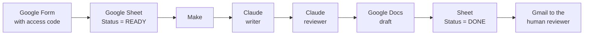

# AI Marketing Department for a Property Manager

An AI team that writes and reviews rental listings, emails and social posts, built with Claude Code, the Claude API and Make, with a human making the final call.

🇺🇸 English · 🇪🇸 [Español](README.es.md)

[PLACEHOLDER: video demo link]


---

## The problem

A residential property management company needs marketing copy for every new rental: a listing, an email to prospects and a social post. The copy must follow the brand voice, never invent facts and comply with Fair Housing law.

The company wants an AI marketing team to do this work. A person still reviews everything before it is published.

**Grow Property Management** (San Diego, California) is a fictional company. The project is inspired by a real job posting, which I do not name here. All company data (license number, phone, domain) is a placeholder.

## What it does

The project has two parts.

**1. Automated flow (Make + Claude API).** Someone fills in a form. A few hours later, a human reviewer gets an email with the three texts already written and reviewed by AI.



- Two Make scenarios. "Form to Sheet" copies new form answers to the sheet. The main scenario takes one `READY` row per run.
- The writer and the reviewer are two separate API calls. Each one has its own system prompt and returns only JSON.
- The email gives the verdict, the publish-ready status, the required pending items and a link to the Doc.
- Nothing is published automatically.

Details: [automatizacion/README.md](automatizacion/README.md) (Spanish).

**2. Claude Code department.** Four subagents and one skill, run from Claude Code:

| Agent | Job |
|---|---|
| `investigador` | Researches neighborhoods and market topics. Tags every fact by source. |
| `planificador` | Builds content calendars. |
| `redactor` | Writes listings, emails and posts. Uses placeholders like `[PRICE]` for missing data. |
| `revisor` | Reviews any text. Read-only. |

The skill `lanzar-propiedad` takes the details of a new property and produces the listing, the email and the post, each one reviewed, then commits them.

All rules live in [CLAUDE.md](CLAUDE.md) and [referencias/](referencias/). File-by-file reference: [docs/project-structure.md](docs/project-structure.md).

## Key design decisions

**Separate writer and reviewer.** A model that checks its own text tends to agree with itself. A second call with a different prompt and a different job catches more errors.

**Read-only reviewer.** In Claude Code, the `revisor` only has Read, Grep and Glob. It can point out problems but cannot fix them silently. Every fix goes back through the writer and is reviewed again.

**Claim-by-claim verification.** The reviewer lists every statement about the property and marks it as supported or not, with its source (the original data, the neighborhood reference, or nothing). A general read let invented details pass. A list of claims does not.

**VERDICT vs. PUBLISH-READY.** The verdict measures quality (APPROVED / APPROVED WITH CHANGES / REJECTED). PUBLISH-READY measures completeness (YES / NO). A text can be well written and still have placeholders. PUBLISH-READY can only be YES when the verdict is APPROVED.

**Word-for-word delegation.** When the main conversation hands a task to a subagent, it passes the user's request verbatim. Anything it adds goes in a separate section called "Added by orchestrator". Agents may treat only the user's own words as "given" facts.

**One source of rules, regenerated.** The Claude API cannot read project files, so the API prompts are copies of the rules. `CLAUDE.md` is the single source. Rule 14 says: when the rules change, regenerate both API prompts and commit them together with the change.

**Error handling.** The writer and reviewer modules (API calls and JSON parsing) have error routes that write the reason in the sheet's `Error` column. The row status (`READY` → `PROCESSING` → `DONE` / `ERROR`) prevents a row from being processed twice. Known gaps in this setup are documented in [automatizacion/README.md](automatizacion/README.md).

**Form with an access code.** Every form answer triggers paid API calls and an email. The form has a first section with an access code, validated by Google Forms (regular expression, exact match). Respondents cannot continue without it. The code is not stored in this repository, and it is not copied to the sheet. Limitation: it is a shared code, not individual authentication; it should be changed if it leaks.

## What broke and how I fixed it

| Symptom | Root cause | Fix |
|---|---|---|
| The writer invented features: "bright", "updated", "overlooking the pool". | The brand guide recommended those words. | Adjectives and features only when the data supports them, plus claim-by-claim verification in the reviewer. |
| The reviewer approved invented details. | It read the text as a whole. | Claim-by-claim verification: every statement needs a source. |
| The API reviewer flagged "close to" as forbidden. | Two copies of the rules had drifted apart. | One distance rule in one source, copied into every file, plus the regeneration rule. |
| A draft was "APPROVED" with 16 placeholders. | The verdict mixed quality and completeness. | A separate PUBLISH-READY line. |
| Empty bullet points with placeholders. | "4–7 bullets" conflicted with "never invent data". | Explicit priority: real features win over bullet count. |
| `[LICENSE]` placeholder even though the user gave the number. The planner marked assumptions as "given". | The orchestrator summarized the user's request before delegating. | Word-for-word delegation and the "Added by orchestrator" section. |
| Every security deposit triggered a legal review. | The legal rule had no clear scope. | Legal review only for texts that explain or interpret laws, rights or fee rules. Stating the property's amounts does not count. |
| Claude wrapped the JSON in ```` ```json ```` despite the instruction. | The model does not always follow format instructions. | Deterministic cleanup in Make: a `replace()` removes the markers before parsing. |
| Responses were cut off (Max Tokens). | The token limit was too low for the output. | Adjusted limits: 4,000 tokens for the writer, 8,000 for the reviewer. |
| The scenario failed when there were no `READY` rows. | Make passes an empty bundle to the next modules. | A filter after the search, so the scenario stops when no row is found. (The `.example.json` blueprint in this repo was exported before the filter was added.) |
| The email summarized the pet policy as "no dogs" without the assistance-animal note. The AI approved it. A human caught it. | The rule was written only for listings. | The note is now required in every text that mentions a pet restriction. If it is missing, the reviewer marks it CRITICAL. |
| Dates like 05/11 were ambiguous. | The form returns DD/MM/YYYY. | Make converts the date to "November 5, 2026" before it reaches Claude. |

## Results

Only what can be checked in this repository:

- 4 Claude Code subagents and 1 skill.
- 2 Make scenarios, exported as blueprints with private IDs replaced by markers.
- 2 self-contained API system prompts (writer and reviewer).
- 14 numbered rules in `CLAUDE.md`.
- 21 commits between October 13 and October 22, 2026, before this case study.
- Test outputs in [salidas/](salidas/): 4 drafts, 5 review reports, 1 research report and 1 content plan. One of the reviews is a trap test: a listing with deliberate Fair Housing violations, which the reviewer rejected with 5 critical issues.
- Cost per property: approx. USD 0.08 per property (writer + reviewer, Claude Sonnet 4.5). Based on token counts from test runs and ~USD 1.01 total API spend during development (October 2026). At 20 properties/month: ~USD 1.60.

## Known limitations

- The reviewer can still miss figurative closeness ("at your doorstep") and headlines without the neighborhood name.
- The writer sometimes copies phrases from the model listings.
- Every run produces a different text. One good test does not guarantee the next one.
- Some error routes leave a row stuck in `PROCESSING`.

That is why the final human review is mandatory. Full list: [automatizacion/limitaciones-conocidas.md](automatizacion/limitaciones-conocidas.md) (Spanish).

## How to run it

**Requirements**

- [Claude Code](https://claude.com/claude-code)
- For the automated flow: a Make account, an Anthropic API key, and a Google account (Forms, Sheets, Docs, Drive, Gmail).

**Claude Code department**

1. Clone the repository and open it in Claude Code.
2. Give it the property details, for example: `/lanzar-propiedad 1 bed / 1 bath condo in Mission Valley, $2,450/month, ...`
3. The drafts appear in `salidas/borradores/` and the reviews in `salidas/revisiones/`.

**Automated flow**

1. Create a Google Sheet from [automatizacion/plantilla-propiedades.csv](automatizacion/plantilla-propiedades.csv).
2. Create a Google Form whose questions follow the same column order.
3. In Make, use *Import Blueprint* with the two `.example.json` files in [automatizacion/](automatizacion/).
4. Reconnect Google and Anthropic, and replace the markers (`[SPREADSHEET_ID]`, `[DRIVE_FOLDER_ID]`, `[YOUR_EMAIL]`…) with your own values.
5. Check that the system prompts in the Claude modules match `prompt-redactor-api.md` and `prompt-revisor-api.md`.
6. Set the schedule for each scenario.

Step-by-step guide: [automatizacion/README.md](automatizacion/README.md) (Spanish).

## Tech stack

- Claude Code (subagents, skills, `CLAUDE.md`)
- Claude API (Sonnet 4.5, called from Make)
- Make
- Google Forms, Sheets, Docs, Drive and Gmail
- Git and GitHub
- Markdown

## About me

I'm Juan, a builder who likes making AI tools work in real business processes. I built this project to learn and to show how I design, test and fix AI agents and automations.

- Background: 5 years in SEO · Head of Off-Page SEO at Kommo (since 2022) · built MindLaw, a legal SaaS with multi-model AI, and my own AI-powered SEO audit tool
- Location: Ecuador · UTC−5 (America/Guayaquil)
- Languages: Spanish (native) · English (B2, written)
- Contact: [LinkedIn](https://www.linkedin.com/in/juan-jos%C3%A9-espinosa-ruiz/) · jjespinosar95@gmail.com

---

*Grow Property Management is a fictional company created for this project.*
